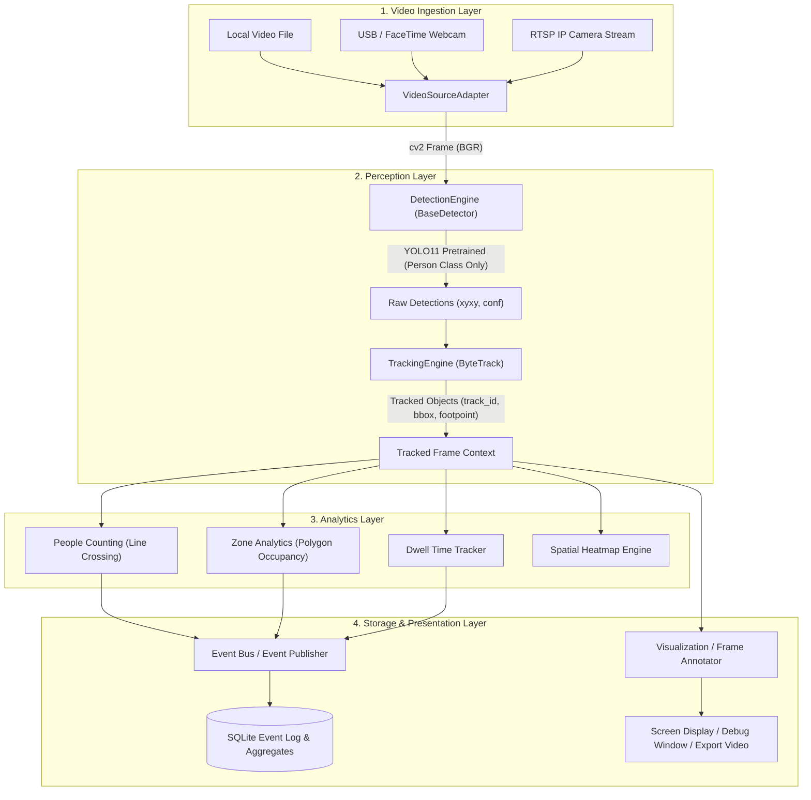

# Architecture Specification

## 1. Overview & Architectural Philosophy

The **Restaurant CCTV Intelligence System (RCIS)** transforms passive CCTV video feeds into structured operational analytics for restaurant managers. 

### Core Architectural Principles:
1. **Separation of Concerns**: Video acquisition, object detection, state tracking, and business analytics are strictly decoupled behind abstract interfaces.
2. **Stateless Detection vs Stateful Tracking**: Object detectors remain pure stateless inference routines. Trajectory maintenance and temporal continuity reside solely within the tracker module.
3. **Decoupled Analytics & Visualization**: Business logic (people counts, dwell duration, zone occupancy) operates purely on tracking coordinates and geometry. Rendering bounding boxes and heatmaps is an optional presentation layer.
4. **Privacy-Preserving by Design**: No facial recognition, biometric identity profiles, or permanent person identifiers are ever constructed or persisted.

---

## 2. Pipeline Flow Diagram



---

## 3. Component Breakdown

### 3.1 Video Source Adapter (`src/rcis/video/`)
- **`BaseVideoSource`**: Abstract base class defining `read()`, `release()`, `is_opened()`, `fps`, `frame_size`, and context manager support (`__enter__`, `__exit__`).
- **`FileVideoSource`**: Handles offline test video files (`.mp4`, `.avi`, `.mkv`). Detects EOF, loops optionally, and provides clean frame seeking.
- **`WebcamSource`**: Captures from local camera indexes (e.g. `0` for MacBook FaceTime camera or external USB UVC cameras).
- **`RTSPSource`**: Encapsulates RTSP network stream acquisition with reconnect retry backoff, frame buffering, and connection health monitoring.

### 3.2 Detection Engine (`src/rcis/detection/`)
- **`BaseDetector`**: Abstract interface taking an RGB/BGR image and returning standardized detections (`sv.Detections`).
- **`YOLODetector`**: Ultralytics implementation targeting COCO class `0` (`person`). Configurable confidence thresholds, IOU threshold, input image size (`imgsz`), and compute device (`mps`, `cpu`, `cuda`).

### 3.3 Tracking Engine (`src/rcis/tracking/`)
- **`BaseTracker`**: Abstract interface taking `sv.Detections` and returning tracked detections with persistent integer `tracker_id`.
- **`ByteTrackTracker`**: Wraps ByteTrack. Maintains temporal track life, Kalman filter state, and velocity estimation.
- **Track Lifecycle Management**: Handles `NEW`, `TRACKED`, `LOST`, and `REMOVED` states without allowing short occlusions to create duplicate visitor counts.

### 3.4 Analytics Engine (`src/rcis/analytics/`)
- **Counting**: Evaluates line crossing vectors using bottom-center anchor points (`footpoint`).
- **Zones**: Evaluates point-in-polygon tests to assess occupancy in defined restaurant zones (Entrance, Dining, Waiting, Cashier, Kitchen/Restricted).
- **Dwell Time**: Measures time elapsed per tracked person inside a target zone.
- **Heatmap**: Accumulates Gaussian footpoint footprints on an image coordinate grid over time.

### 3.5 Storage & Events (`src/rcis/events/`, `src/rcis/storage/`)
- Structured JSON-compatible event payloads:
  ```json
  {
    "event_id": "uuid4",
    "timestamp": "2026-11-06T11:00:00Z",
    "event_type": "zone_entry",
    "camera_id": "cam_main_dining",
    "track_id": 42,
    "zone_id": "waiting_area",
    "metadata": {"dwell_sec": 0.0}
  }
  ```
- Events and hourly aggregates are stored in SQLite; raw pixel data and high-frequency tracking trajectories are not persisted.
